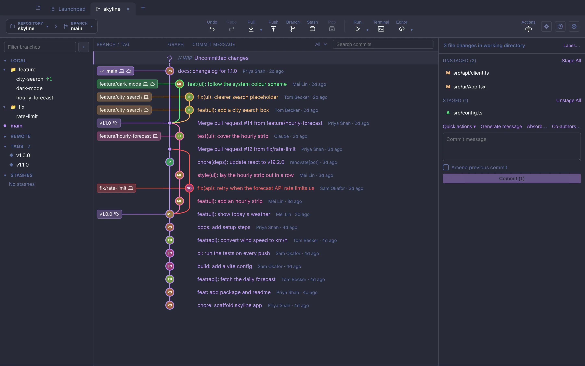
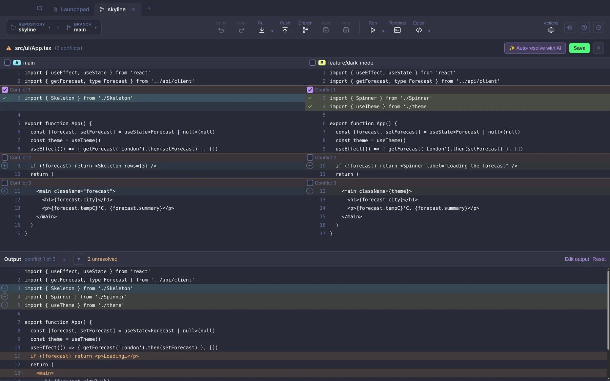
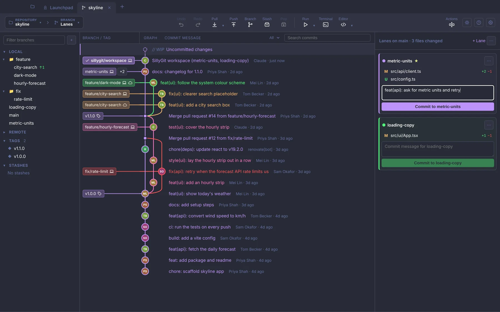
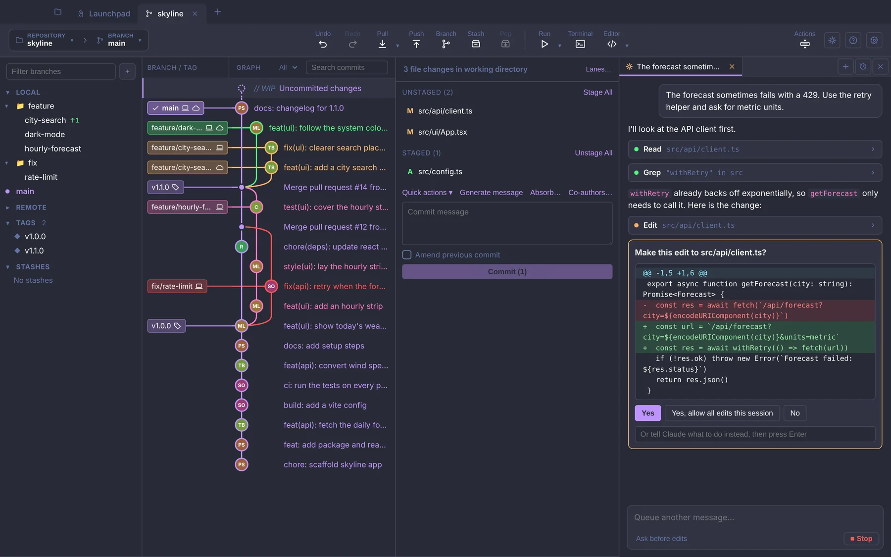
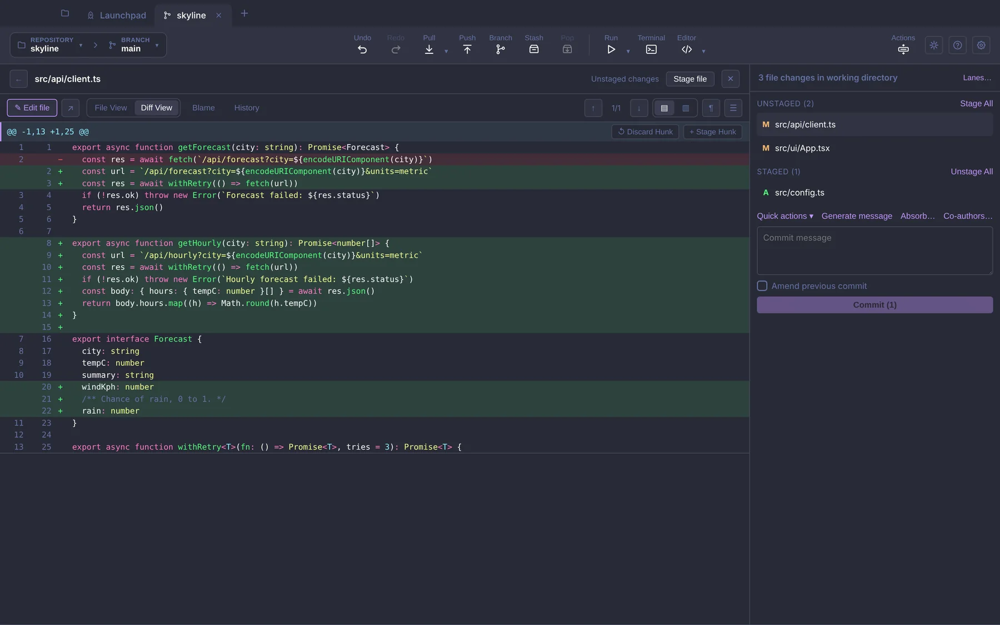
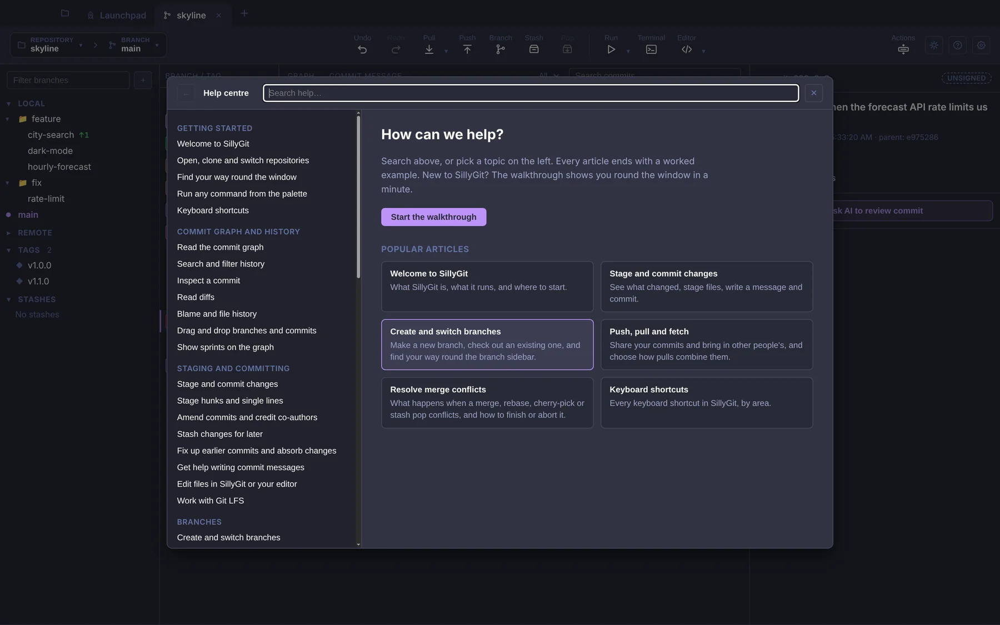

<div align="center">


# SillyGit

**A desktop Git client with a commit graph, line staging, a three-way merge editor and Claude Code built in.**

[](https://github.com/bryn-hill/sillygit/actions/workflows/ci.yml)
[](https://github.com/bryn-hill/sillygit/releases/latest)
[](LICENSE)


[**Download**](#download) · [Website](https://bryn-hill.github.io/sillygit/) · [Features](#features) · [Run from source](#run-from-source) · [Contributing](#contributing)

<br>

<picture>
  <source media="(prefers-color-scheme: light)" srcset="docs/images/graph-light.webp">
  
</picture>

</div>

SillyGit draws your history as a graph, lets you stage a single line, gives you a three-way
editor for merge conflicts, and can run Claude Code in the repository you have open. It also
handles pull requests from GitHub and Azure DevOps, and issues from GitHub, Jira and Azure
Boards. It's free and MIT licensed.

## It runs your Git

SillyGit doesn't bring its own copy of Git. Every button runs the `git` already on your
machine, with your config, hooks, credentials and signing keys, and **Actions → Activity log**
lists the exact commands it ran.

So you can drop into a terminal whenever you like. The graph and file list update when the
repository changes on disk, and **Undo** works from Git's reflog, which means it can take back
a commit, checkout, merge, rebase or reset even if you ran it in the terminal.

## Download

The latest build is on **[GitHub Releases](https://github.com/bryn-hill/sillygit/releases/latest)**. This is an early release.

| Platform | File |
| --- | --- |
| macOS, Apple silicon | `SillyGit-<version>-mac-arm64.dmg` |
| macOS, Intel | `SillyGit-<version>-mac-x64.dmg` |
| Windows 10/11, 64-bit | `SillyGit-<version>-win-x64.zip` (portable: unzip and run `SillyGit.exe`) |
| Linux | Build an AppImage from source with `npm run dist` (see [below](#run-from-source)) |

The builds aren't signed yet, so your system warns you the first time you open SillyGit. On
**macOS**, right-click the app and choose **Open**, or use **System Settings → Privacy &
Security → Open Anyway**. On **Windows**, if SmartScreen stops it, click **More info**, then
**Run anyway**. [RELEASING.md](RELEASING.md) has the details and the checksums file.

You need **Git** installed. For the GitHub features, sign in to the
[GitHub CLI](https://cli.github.com/) with `gh auth login` and to
[Claude Code](https://claude.com/claude-code) (or set an Anthropic API key in Settings).

## Features

<table>
<tr>
<td width="50%" valign="top">
<picture>
  <source media="(prefers-color-scheme: light)" srcset="docs/images/conflict-light.webp">
  
</picture>
<b>Merge conflicts.</b> Your side and their side next to each other, with the result
underneath. Pick lines or chunks from either side, edit the result by hand, or take one side
for many files at once.
</td>
<td width="50%" valign="top">
<picture>
  <source media="(prefers-color-scheme: light)" srcset="docs/images/lanes-light.webp">
  
</picture>
<b>Lanes.</b> Several branches checked out in one folder. Each change belongs to a lane, and
each lane commits to its own branch, so an unrelated fix doesn't end up in your feature.
</td>
</tr>
<tr>
<td width="50%" valign="top">
<picture>
  <source media="(prefers-color-scheme: light)" srcset="docs/images/claude-light.webp">
  
</picture>
<b>Claude Code in a side panel.</b> By default it asks before editing a file or running a
command, and shows you the diff or command first. Its changes land in your working copy.
</td>
<td width="50%" valign="top">
<picture>
  <source media="(prefers-color-scheme: light)" srcset="docs/images/diff-light.webp">
  
</picture>
<b>Staging, fixups and absorb.</b> Stage or discard single lines. Fold fixes into older
unpushed commits, one at a time or all at once with <b>Absorb</b>.
</td>
</tr>
<tr>
<td width="50%" valign="top">
<picture>
  <source media="(prefers-color-scheme: light)" srcset="docs/images/help-light.webp">
  
</picture>
<b>Help inside the app.</b> Press <kbd>F1</kbd> or <kbd>?</kbd> for 53 short articles, each
ending with a worked example, plus a walkthrough the first time you open a repository.
</td>
<td width="50%" valign="top">

**Also in there**

- Interactive rebase: drag commits to reorder, squash or drop
- `git bisect`, git-flow and stacked branches
- Pull requests: review, open and check out locally
- Accounts for GitHub, GitLab, Bitbucket, Gitea and Azure DevOps
- **Start work** on an issue or Jira ticket to get a branch for it
- Blame, file history and image diffs
- Built-in editor, terminal and command palette
- Light and dark themes, or follow the system

</td>
</tr>
</table>

<details>
<summary><b>Full feature list</b></summary>

### Commit graph and history

- Commit graph with coloured lanes, a Branch / Tag column, author avatars
  (including bot logos for Claude and Renovate), and smooth scrolling for large
  histories.
- Animations for new commits, merges and commits arriving from a pull or fetch.
- Search history by message, author, path or changed content (`-S` / `-G`), and
  filter the graph to a folder.
- Optional sprint markers on the graph.
- Drag a branch onto another to merge, rebase or cherry-pick.
- Commit menu: check out, create branch or tag, cherry-pick, revert, reset,
  fix up with staged changes, start a bisect, interactive rebase, and more.
- Full commit view with the file list, diffs, signature badge (Verified,
  Unverified, Unsigned) and co-authors.
- Shows where a merged branch landed.

### Working copy and committing

- Live working-tree status that updates as files change.
- Stage, unstage or discard whole files, single hunks or individual lines.
- Commit with co-authors picked from history, amend the last commit, and undo
  or redo common operations.
- Fix up an earlier commit with staged changes, or **Absorb** staged hunks into
  the unpushed commits they belong to.
- Stashes: create, apply, pop and drop.
- Apply a patch, clone a repo, and see an activity log of what SillyGit ran.

### Diffs, files and editing

- Unified and split diffs with syntax highlighting, horizontal scrolling and an
  ignore-whitespace option.
- Image diffs side by side, as a swipe or as an onion skin.
- Blame and file history for any file.
- Full-window file diff or history with the file list kept beside it; use the
  arrow keys to move between files.
- Built-in Monaco editor for quick edits, plus **Open in editor** for your IDE.
- Git LFS: pointer files are shown as their real content, with track and untrack
  actions and a warning when LFS isn't installed.

### Branches and workflows

- Branch menu with checkout, merge, rebase, rename, delete, push, copy name and
  pull (fast-forward without checking out).
- Sidebar branch status: deleted on remote, stale, ahead/behind, favourites.
- **Clean up branches** dialog that finds merged and stale branches for you.
- Sidebar lists for tags, worktrees and submodules.
- Interactive rebase editor: reorder, squash, fixup, reword and drop by drag and
  drop, without a text editor.
- Guided `git bisect` from the commit menu, including running a test command.
- git-flow start and finish for features, releases and hotfixes, without the
  git-flow binary.
- Stacked branches with one-click restack.
- **Lanes**: work on several branches at once in one working tree, then commit
  each lane to its own branch.
- Toolbar with Undo, Redo, Pull (merge, rebase or fast-forward only), Push,
  Branch, Stash, Pop, Terminal and an Actions menu.
- Run button: run a per-repo command, or run a selected commit in a private
  worktree.
- Custom shell commands in menus and the command palette.
- Rule-based quick actions for routine commits and PRs.

### Merge conflicts

- Conflict detection for merges, rebases, cherry-picks and stash pops, with a
  file menu to take ours, theirs or both.
- Three-way merge resolver with per-chunk choices and manual edits.
- Multi-select to resolve many files at once, with undo.
- Optional external merge tool.
- AI suggestions for resolving conflicts.

### Pull requests, issues and accounts

- Accounts for GitHub, GitLab, Bitbucket, Gitea and Azure DevOps using personal
  access tokens, stored with Electron's secure storage.
- **Launchpad** with your pull requests, assigned issues, Jira issues and Azure
  Boards work items.
- Create pull requests in the app.
- Review pull requests: conversation, files changed, comments and approvals.
- Check out a pull request as a local branch, including from forks.
- **Start work** on an issue, Jira ticket or work item: creates a branch and
  links the commit and PR back to it. Jira keys in commit messages become links.
- Desktop notifications for pull request activity.

### AI and Claude

- **Claude panel**: a chat with Claude Code inside the app, with permission
  cards for edits and commands, and plan approval.
- AI review of a diff, AI commit messages, and AI help splitting a large change
  into several commits.
- AI suggestions in the merge conflict tool.

### App

- Multi-repo tabs with pinning, and the last session restored on launch.
- Integrated terminal (xterm.js with WebGL).
- Command palette for nearly every action.
- Light, dark or system theme.
- Resizable side bar and detail panel, and a layout that still works at half
  screen width.
- Update SillyGit button for source checkouts (see
  [Keeping a checkout up to date](#keeping-a-checkout-up-to-date)).

### Walkthrough and help

- **First-use walkthrough**: the first time a repository is open, a short tour
  spotlights the main areas (tabs, graph, branches, committing, pull and push,
  undo, Launchpad, the command palette, Claude, Settings) one at a time. Skip it
  with **Skip tour** or Esc, move with the arrow keys, and start it again any
  time from **Help → Start walkthrough** or **Help: Start walkthrough** in the
  command palette.
- **Help centre**: over 50 articles, each with a worked example, covering every
  feature from the graph to lanes, conflicts, integrations and Claude. Open it
  with **F1**, **?**, the **Help** button next to Settings, or **Help: Open help
  centre** in the palette; every article is also in the palette by title. Search
  matches titles, summaries, keywords and article text, with results grouped by
  topic. **Help → Keyboard shortcuts** lists every shortcut, and each walkthrough
  step's **Learn more** opens the article for that area.

</details>

For how each feature works, open the help centre in the app (<kbd>F1</kbd>). The articles
are also readable on GitHub in
[`src/renderer/src/help/articles/`](src/renderer/src/help/articles/).

## Run from source

You need **Node.js 22** (what CI uses), npm, and **Git** on your `PATH`. Git LFS is optional;
SillyGit tells you when it's missing.

```bash
git clone https://github.com/bryn-hill/sillygit.git
cd sillygit
git checkout dev     # day-to-day work happens on dev; main is the stable branch
npm install
npm run dev          # Electron with hot reload
```

`npm install` also downloads Electron, fixes native-module permissions and points git at the
repo's hooks in `.githooks/` (see [Commit messages](#commit-messages)). If `npm run dev`
reports that Electron is not installed, run `node node_modules/electron/install.js`. After
pulling changes that add dependencies, run `npm install` again; a stale `node_modules` causes
confusing type errors.

| Command | What it does |
| --- | --- |
| `npm run dev` | Development mode with hot reload (Vite + Fast Refresh). |
| `npm run build` | Builds main, preload and renderer into `out/`. |
| `npm start` | Runs the built app from `out/` without the dev server. |
| `npm run dist` | Installer in `dist/`: `.dmg` + `.zip` on macOS, NSIS on Windows, AppImage on Linux. |
| `npm run dist:dir` | Unpacked app in `dist/` that you can run straight away. |

macOS builds are ad hoc signed and not notarized, so the first launch needs right-click >
**Open**. If the integrated terminal fails in a packaged build on Linux, run
`npm rebuild node-pty` and build again. [RELEASING.md](RELEASING.md) covers how the published
releases are made.

### Keeping a checkout up to date

If you run SillyGit from a clone of this repo, the **Update SillyGit** button in the top bar
checks `origin/main` every 30 minutes. One click fast-forwards your checkout, runs
`npm install` when the lockfile changed, rebuilds and relaunches. It deliberately follows
`main`, not `dev`, and is turned off in packaged builds.

## Running the tests

| Command | What it runs |
| --- | --- |
| `npm test` | Unit and component tests (Vitest, jsdom). |
| `npm run test:coverage` | The same, with a V8 coverage report. |
| `npm run test:e2e` | Builds the app, then runs the Playwright end-to-end suite against it. |
| `npm run typecheck` | TypeScript for main, preload and renderer. |
| `npm run lint` | ESLint for `src/renderer`, including the React Compiler rules. |
| `npm run lint:commits` | Checks every commit on your branch that isn't on `origin/dev`. |

Unit tests create throwaway git repos and use `vitest.gitconfig` instead of your global git
config, so commit signing or hooks on your machine don't slow them down or break them.

<details>
<summary><b>End-to-end tests</b></summary>

The e2e suite (`e2e/`) drives the real Electron app with Playwright, using page objects in
`e2e/pages/` and specs in `e2e/specs/`. Each Playwright worker shares one app instance, and
specs run in parallel.

- On macOS and Windows the test window is invisible and never takes focus, so you can keep
  working while the suite runs.
- Set `E2E_SHOW_WINDOW=1` to watch the tests drive the app.
- On Linux without a display (containers, CI boxes), use a virtual one:

  ```bash
  npm run build
  CI=1 xvfb-run -a npx playwright test
  ```

- Run a single spec with `npx playwright test e2e/specs/lanes.spec.ts` (after
  `npm run build`, since e2e runs against `out/`).

New tests should find elements by ARIA role, label or a `data-testid`, not by CSS class.

</details>

## Contributing

Contributions are welcome. The short version:

1. **Branch from `dev` and open pull requests against `dev`.** `main` is the stable branch and
   only receives `dev` when a release is promoted. Don't target `main` directly.
2. **Write [Conventional Commits](#commit-messages)** and run `npm run lint:commits` before you
   push.
3. **Run `npm run typecheck`, `npm run lint` and `npm test`.** If you change behaviour that an
   e2e spec covers, run that spec too.
4. **Follow the [renderer rules](#renderer-code)**, and when you add or change a feature,
   update its help article too.

[CONTRIBUTING.md](CONTRIBUTING.md) has the full details, everyone is expected to follow the
[Code of Conduct](CODE_OF_CONDUCT.md), and [CLAUDE.md](CLAUDE.md) holds the same rules for AI
agents working on the repo.

### Commit messages

Commits follow `type(scope): subject`, with a lowercase subject and no trailing period, for
example:

```
feat(conflicts): add an external merge tool option
fix(terminal): keep powerline glyphs aligned
```

Types are `feat`, `fix`, `perf`, `refactor`, `style`, `test`, `docs`, `build`, `ci`, `chore`
and `revert`. Scopes name the area of the app (`graph`, `commit`, `conflicts`, `launchpad`,
...). See [CONTRIBUTING.md](CONTRIBUTING.md) for the full list. A `commit-msg` hook checks each
message as you commit, and CI rejects anything that doesn't fit.

### Renderer code

- `src/renderer` must pass `npm run lint` (eslint-plugin-react-hooks with the React Compiler
  rules). Follow
  [You Might Not Need an Effect](https://react.dev/learn/you-might-not-need-an-effect): derive
  values while rendering, reset state with a `key`, keep effects for syncing with outside
  systems, and use `useEffectEvent` rather than assigning refs during render. If you have to
  silence a rule, add a comment saying why it's a false positive.
- Put hooks in `.tsx` files, even without JSX. Vite only gives `.tsx` files Fast Refresh
  signatures, so a hook in a `.ts` file can crash on a hot update.
- Keep the exports of component files to components (and constants), or Fast Refresh falls
  back to a full reload.
- Use the theme tokens for colours in new CSS, so the light and dark themes both work.
- Anything placed near the top of the window must not sit in the macOS window-drag region
  (`-webkit-app-region: drag`), or it won't receive clicks.

### Help articles and the walkthrough

Articles live one per file in `src/renderer/src/help/articles/<category>/` and are registered
in `articles/index.ts`; link between them in Markdown with `[text](help:<category>/<slug>)`.
Code for the help centre and walkthrough lives in `src/renderer/src/help/`, with the shared
types in `src/shared/help/`. When a walkthrough change is worth showing to people who already
finished it, bump `TOUR_VERSION` in `src/shared/help/tour.ts`.

### CI

CI (`.github/workflows/ci.yml`) runs on every pull request and on pushes to `dev` and `main`:

- **commits** checks every new commit message.
- **test** runs `npm ci`, typecheck, lint and the unit tests.
- **End-to-end tests** only run for `main` (pushes to it and pull requests into it), so merging
  into `dev` stays quick. Run the e2e specs you touch yourself.

The runner is a self-hosted macOS (Apple silicon) machine. Pull requests from forks don't run
on it, so a maintainer will run checks for those. Actions are pinned to commit SHAs and jobs get
a read-only token.

### Project layout

```
src/main/       Electron main process: git, hosting providers, AI, terminal, IPC
src/preload/    The bridge the renderer uses to call main
src/renderer/   React UI (components, hooks, styles)
src/shared/     Types and pure logic used by both sides
e2e/            Playwright suite: fixtures, page objects, specs
docs/           The project website (GitHub Pages) and README images
scripts/        Install helpers and the commit message checker
resources/      App icon and bot avatars
```

## Licence and security

SillyGit is open source under the [MIT licence](LICENSE). To report a security problem, follow
[SECURITY.md](SECURITY.md) rather than opening a public issue.
